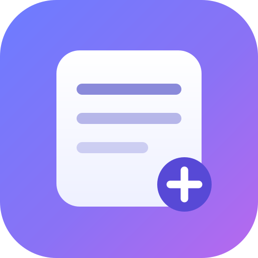

<div align="center">
  
  <h1>纯粹备忘录</h1>
  <p>打开就写，退出即存的极简卡片备忘录。</p>
  <p><em>A zero-backend, offline-first memo PWA. All data stays on your device.</em></p>
</div>

---

一个零后端、纯前端的单页 PWA。所有数据只保存在本机 `localStorage`，支持离线使用，可安装到手机主屏幕；另提供 Android APK。

## 特性

- **打开就写**：启动或回到前台时，看板顶部自动展开一张整行输入大卡；输入内容实时保存为草稿，切到后台或退出页面时自动落成卡片。
- **卡片看板**：按「置顶 / 今天 / 昨天 / 日期」分组，支持双列 / 单列视图。
- **就地编辑**：点任意卡片，直接在置顶分组上方展开一张整行大卡片改写，取消不改动原文；没有弹层，也没有全屏编辑页。
- **拖拽排序**：按住卡片（约 0.3 秒）会把它"拿起来"——卡片浮起、跟着手指带一点惯性倾斜，其余卡片带着加减速让位；拖进「置顶」分区就变成置顶，从置顶分区往下拖出来即取消置顶；松手后卡片落回格子，靠近上下边缘会自动滚动。拖拽期间会临时关掉毛玻璃改用实色、并冻结背景动画，把合成预算全留给跟手的卡片。
- **快捷操作**：点卡片右上角 ⋯ 打开就地菜单，可置顶、转为长期留存、复制、删除；删除、清空、转存均可在约 5 秒内撤销。
- **长期留存**：三个独立分页的纯文本区，输入即存；卡片可转存到指定页，不再占用看板位置；支持复制或清空当前页。
- **深浅主题**：默认跟随系统，也可手动切换。
- **离线优先**：Service Worker 缓存应用资源，断网后仍可打开使用。
- **本地优先**：无账号、无服务器，数据不会上传到任何地方。
- **Android APK**：内置 WebView 壳，离线运行，数据保存在 App 内。

## 快速开始

Service Worker 需要 `localhost` 或 HTTPS 环境，直接双击打开 `index.html`（`file://`）不会启用离线缓存。

```bash
# 任选其一，在项目根目录启动静态服务器
python -m http.server 8000
# 或
npx serve .
```

然后访问 <http://localhost:8000>。

## 安装到手机

- **iOS Safari**：分享菜单 → 添加到主屏幕。
- **Android Chrome**：浏览器菜单 → 安装应用 / 添加到主屏幕。
- **Android APK**：下载 [PureMemo-v1.0.apk](release/PureMemo-v1.0.apk)，允许「安装未知来源应用」后安装。最低支持 Android 7.0，安装包为自签名。

> APK 基于 v1.0 构建；网页端后续的改动不会自动同步进 APK。

## 数据说明

所有内容保存在浏览器的 `localStorage` 中：

| 键 | 内容 |
| --- | --- |
| `purememo.cards.v1` | 卡片列表 |
| `purememo.draft.v1` | 未提交的草稿 |
| `purememo.settings.v1` | 视图、主题、当前留存页 |
| `purememo.pages.v1` | 三页长期留存文本 |
| `purememo.archive.v1` | 旧版单页留存文本，仅用于迁移 |

> **重要**：清除浏览器站点数据、使用无痕模式或卸载 APK 都会导致数据丢失。当前版本没有导出/导入功能，请勿将本应用作为重要内容的唯一备份。

## 项目结构

```text
.
├── index.html                  # 单文件应用（HTML + CSS + JS）
├── manifest.webmanifest        # PWA 清单
├── sw.js                       # Service Worker 离线缓存
├── assets/icons/               # 应用图标
├── scripts/
│   ├── generate_icons.py       # 纯标准库生成 PNG 图标
│   └── check_references.py     # 校验页面资源引用完整性
├── release/
│   └── PureMemo-v1.0.apk       # Android 安装包
├── docs/
│   ├── CHANGELOG.md            # 变更记录
│   └── DEVELOPMENT.md          # 架构与开发说明
└── .github/workflows/
    └── validate.yml            # 资源引用与语法校验
```

单文件 `index.html` 是刻意设计：无构建步骤、离线缓存简单，也便于嵌入 Android WebView。

## 开发

无需安装依赖，也没有构建步骤。

```bash
# 重新生成图标
python scripts/generate_icons.py

# 校验 HTML / manifest / Service Worker 中的本地资源引用
python scripts/check_references.py
```

修改 `sw.js` 里的缓存资源后，请同步递增 `CACHE` 版本号，以淘汰旧缓存。

## 部署

可部署到任意静态托管服务（GitHub Pages、Cloudflare Pages、Vercel 等），保持仓库根目录作为站点根目录即可。

GitHub Pages：

1. 进入仓库 **Settings → Pages**；
2. Source 选择 **Deploy from a branch**；
3. Branch 选择 **main**，目录选择 **/ (root)**；
4. 保存后访问 <https://boyang-web.github.io/pure-memo/>。

## 技术栈

- 原生 HTML / CSS / JavaScript，无框架、无运行时依赖
- Web App Manifest + Service Worker（PWA、离线缓存）
- `localStorage` 本地持久化
- Python 标准库生成图标
- Android WebView 壳（APK）

## 许可证

[MIT](LICENSE)
